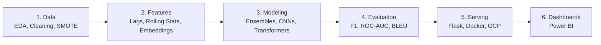

---

## 👋 About Me

I'm a **Computer Science (AI & ML)** graduate from **VIT-AP University** (CGPA 8.21) and currently pursuing a **PG Diploma in Big Data Analytics at CDAC Noida**. I build machine learning systems end to end: messy data → model → containerized API → cloud deployment.

- 🔭 Focused on **Hybrid RAG, Computer Vision, and Distributed Data Pipelines**
- 🌱 Currently learning **Kubernetes & MLOps**
- 📍 Open to roles in **Bengaluru · Hyderabad · Pune · Gurgaon**
- 💼 Looking for **AI/ML Engineering, Data Engineering, Data Analytics, and SWE** roles

---

## 🛠️ Tech Stack

**Languages & Data**

**ML / DL / GenAI**

**Backend, Cloud & BI**

---

## 🚀 Featured Projects

<table>
<tr>
<td width="50%" valign="top">

### ⚡ Power Theft Detection System
Distributed anomaly detection on smart-grid data.

- Handled **<3% class imbalance** with SMOTE
- Weighted RF + GBM ensemble → **15% accuracy gain**
- PySpark DAG tuning → **40% faster** processing
- Power BI dashboard with regional anomaly heatmaps

`PySpark` `Scikit-learn` `XGBoost` `Power BI`

[🔗 View Repo](https://github.com/rajavardhantalathoti/REPO_NAME)

</td>
<td width="50%" valign="top">

### 🏥 CareSync-AI
Hospital onboarding & insurance claim portal.

- **Dual-retriever Hybrid RAG**: ChromaDB + BM25Okapi
- Gemini 1.5 Flash extracts structured clinical JSON
- SHA-256 tamper-evident document sealing
- Patient, MRD, and Admin role-based views

`Flask` `ChromaDB` `Gemini` `SQLite`

[🔗 View Repo](https://github.com/rajavardhantalathoti/REPO_NAME)

</td>
</tr>
<tr>
<td width="50%" valign="top">

### 🩺 Skin Cancer Detection Platform
CNN-based dermoscopic lesion classifier.

- ResNet50 / MobileNetV2 transfer learning → **93%+ accuracy**
- Uncertainty thresholding routes low-confidence cases to doctors
- Dockerized Flask API on **GCP Compute Engine**
- Bilingual UI (English + Telugu)

`TensorFlow` `Keras` `Docker` `GCP` `MongoDB`

[🔗 View Repo](https://github.com/rajavardhantalathoti/REPO_NAME)

</td>
<td width="50%" valign="top">

### 🌐 Context-Aware Translation & Learning
Neural machine translation with domain RAG.

- Fine-tuned **MarianMT** for English–Telugu / English–Hindi
- Evaluated with BLEU + manual validation
- RAG with citation-backed answers
- Voice pipeline with STT and TTS

`Hugging Face` `PyTorch` `RAG` `NLP`

[🔗 View Repo](https://github.com/rajavardhantalathoti/REPO_NAME)

</td>
</tr>
<tr>
<td colspan="2" valign="top">

### 🏋️ Full-Stack Fitness Tracker (MERN)
JWT auth with bcrypt, REST APIs, MongoDB aggregation pipelines for calorie and streak tracking, and a React dashboard. &nbsp;·&nbsp; `MongoDB` `Express` `React` `Node.js` &nbsp;·&nbsp; [🔗 View Repo](https://github.com/rajavardhantalathoti/REPO_NAME)

</td>
</tr>
</table>

---

## 🏛️ How I Build ML Systems

---

## 📊 GitHub Stats

---

## 🎓 Education & Certifications

| Qualification | Institution | Year | Score |
|---|---|---|---|
| PG Diploma in Big Data Analytics | CDAC Noida | 2025–26 | Pursuing |
| B.Tech CSE (AI & ML) | VIT-AP University | 2021–25 | 8.21 CGPA |

🏅 Claude Code in Action (Anthropic) · Career Essentials in Generative AI (Microsoft & LinkedIn) · Google Cloud Computing Foundations · Image Processing Onramp (MathWorks) · MERN Full Stack (Ethnus)

---

## 💡 Engineering Principles

- **Data quality beats model complexity.** Good features and imbalance handling go further than bigger models.
- **Hybrid beats pure-play.** Dense plus sparse retrieval cuts hallucinations in high-stakes domains.
- **Know what you don't know.** Healthcare models should flag uncertainty and hand off to humans.
- **Ship it.** A notebook has no business value until it's containerized, tested, and measured.

---

### 🤝 Let's connect

Open to full-time roles in **ML Engineering · Data Engineering · Data Analytics · Generative AI**

